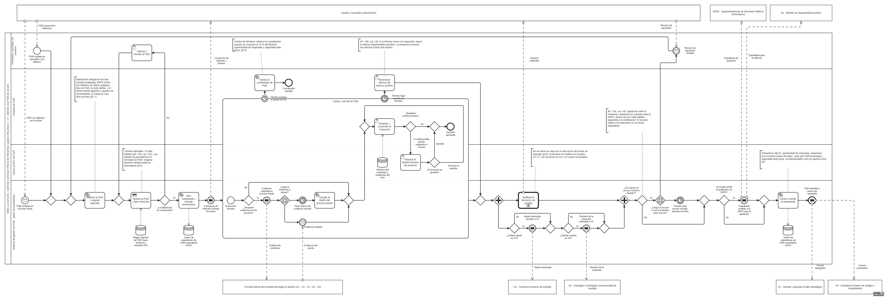

# ENEL · Arquitectura distribuida

El repositorio conserva los modelos BPMN/DMN/forms y el motor Camunda bajo `EMSA_springboot/`. La solución
se ejecuta como cuatro aplicaciones Spring Boot independientes y un pequeño módulo Java compartido
(`EMSA-Dominio/`) para el esquema de solicitudes:

| Aplicación | Puerto | Responsabilidad |
|---|---:|---|
| `EMSA_springboot/` | 8081 | Camunda 7.24, despliegue BPMN/DMN/forms, CORS y delegados |
| `EMSA-Portal-Ciudadano/` | 8082 | Borradores C2/C7, edición, historial y radicación |
| `EMSA-CentralSys/` | 8083 | Consulta de tareas, formulario desplegado, claim y completado |
| `EMSA-Servicios-Core/` | 8084 | Liquidación tarifaria, órdenes técnicas y validaciones |

Las tres aplicaciones de dominio comparten `enel_negocio`; Camunda usa su base independiente `enel_camunda`.
Por defecto se crean como archivos H2 con `AUTO_SERVER=TRUE`, sin servicio externo. El motor conserva `com.soft1`;
las aplicaciones nuevas usan `com.enel`. El Portal valida los nombres de variable de C2/C7 contra los
formularios BPMN existentes. C2 se inicia por `restablecerServicioTrasFalla`; C7 se correlaciona con
`MsgPQRPortal`. En ambos casos el código `SOL-...` se envía como business key y también como `codigoSolicitud`.
Los delegates de liquidación C4 y orden técnica C2 invocan el Core por HTTP.

## Arquitectura y componentes

Consulte el [diagrama y descripción de arquitectura](docs/arquitectura-distribuida.md), los
[criterios de evaluación y evidencias](docs/arquitectura-distribuida.md#evidencia-para-la-evaluacion)
y las guías de cada componente: [motor Camunda](EMSA_springboot/README.md),
[Portal Ciudadano](EMSA-Portal-Ciudadano/README.md), [CentralSys](EMSA-CentralSys/README.md),
[Servicios Core](EMSA-Servicios-Core/README.md) y [biblioteca de dominio](EMSA-Dominio/README.md).
Los componentes están organizados en este repositorio integrador; sus carpetas son módulos de construcción,
no clones Git separados.

## Ejecutar localmente

Requiere Java 17+ y Maven 3.9+. En el primer clonado instale los módulos y dependencias locales del reactor:

```powershell
mvn clean install -DskipTests
```

Después abra una terminal por aplicación y arránquelas en este orden:

```powershell
cd EMSA_springboot
mvn spring-boot:run
```

```powershell
cd EMSA-Servicios-Core
mvn spring-boot:run
```

```powershell
cd EMSA-Portal-Ciudadano
mvn spring-boot:run
```

```powershell
cd EMSA-CentralSys
mvn spring-boot:run
```

También se puede compilar todo el reactor desde la raíz con `mvn clean verify`. Portales: `http://localhost:8082/`
y `http://localhost:8083/`; Camunda Tasklist/Admin: `http://localhost:8081/camunda/app/` (demo/demo);
REST: `http://localhost:8081/engine-rest`.

Los borradores no requieren Camunda. Para radicar C2/C7, el motor debe estar arriba; para ejecutar tasks de
liquidación u órdenes técnicas también debe estar activo Core. Los archivos de base quedan dentro de `data/`
(excluidos de Git). En cada módulo externo, `../data/enel_negocio` apunta al mismo archivo compartido.

### PostgreSQL opcional

`docker compose up -d` levanta PostgreSQL y crea las bases `enel_camunda` y `enel_negocio`. Para cada proceso,
configure antes de arrancar:

```powershell
$env:ENEL_CAMUNDA_JDBC_URL='jdbc:postgresql://localhost:5432/enel_camunda'
$env:ENEL_CAMUNDA_JDBC_DRIVER='org.postgresql.Driver'
$env:ENEL_CAMUNDA_DB_USER='enel'
$env:ENEL_CAMUNDA_DB_PASSWORD='enel-local'
$env:ENEL_NEGOCIO_JDBC_URL='jdbc:postgresql://localhost:5432/enel_negocio'
$env:ENEL_NEGOCIO_JDBC_DRIVER='org.postgresql.Driver'
$env:ENEL_NEGOCIO_DB_USER='enel'
$env:ENEL_NEGOCIO_DB_PASSWORD='enel-local'
```

Las URLs/credenciales de Camunda, Core y CORS también se pueden cambiar con `ENEL_CAMUNDA_URL`,
`ENEL_SERVICIOS_CORE_URL` y `ENEL_CORS_ALLOWED_ORIGINS`. El correo se activa configurando SMTP,
`ENEL_MAIL_FROM` y `ENEL_EMAIL_ENABLED=true`; por defecto queda apagado para que el proyecto funcione sin
servidor de correo.
Las cuentas Camunda de demostración conservan los usuarios y grupos definidos en el README técnico.

## Verificación integral

Con las cuatro aplicaciones iniciadas, ejecute desde la raíz con Python 3:

```powershell
python scripts/verify-integration.py
```

La prueba comprueba la validación del Portal, persistencia de órdenes en Core, radicación C2 y C7, business
keys en Camunda, lectura de formulario/variables desde CentralSys, claim/completado de la tarea C2,
sincronización del estado compartido y el delegate de liquidación C4 consumiendo el resultado de Core. Crea
solicitudes, una orden y una instancia C4 de prueba; los registros permanecen en la base local. Para probar
otros hosts, defina `ENEL_PORTAL_URL`, `ENEL_CENTRAL_URL`, `ENEL_CORE_URL` y `ENEL_ENGINE_URL`.

---

# ENEL La Corocora (EMSA) · Procesos BPM ejecutables en Camunda 7

Proyecto del curso de profundización **Software 1** (Universidad de los Llanos). Los procesos de negocio
del caso *ENEL La Corocora* están modelados en BPMN, DMN y Camunda Forms para **Camunda Platform 7.24** y
se ejecutan en modo *standalone*: una sola aplicación **Spring Boot** con el motor de Camunda embebido.
No hay que instalar Camunda Run ni levantar workers aparte.

---

## Nombre del proyecto

**ENEL La Corocora — Sistema de Gestión y Automatización de Procesos de Distribución y Comercialización
de Energía Eléctrica** (caso de estudio basado en la Electrificadora del Meta S.A. E.S.P., EMSA).

## Integrantes del grupo y proceso de negocio a cargo

| Integrante (nombre completo) | Proceso de negocio del que se hizo cargo |
|---|---|
| JESSICA MARCELA BAQUERO MEJÍA | **C2** · Restablecer el servicio tras una falla |
| MIGUEL ANGEL TRASLAVIÑA RODRIGUEZ | **C4** · Facturar el servicio de energía |
| DUVAN FELIPE BAQUERO CERQUERA | **C7** · Atender una PQR del usuario |

---

## Proyecto del que se hizo responsable cada integrante

Todos los procesos viven en la aplicación [`EMSA_springboot`](EMSA_springboot). Los modelos están en
`EMSA_springboot/src/main/resources` y la lógica de las tareas de servicio (`JavaDelegate`) en
`EMSA_springboot/src/main/java/com/soft1/<proceso>`.

### 1. C2 · Restablecer el servicio tras una falla

- **Estudiante:** JESSICA MARCELA BAQUERO MEJÍA
- **Proceso que asumió:** C2 · Restablecer el servicio tras una falla técnica: atención de avisos de
  interrupción, validación de alarmas en la red, visita técnica, inspección en terreno, despacho de
  cuadrillas, reparación y restitución del suministro.
- **Nombre de la carpeta en el repositorio:**
  - Modelos: `EMSA_springboot/src/main/resources/static.bpmn`, `static.dmn` y `static.form` (archivos de C2)
  - Código Java: `EMSA_springboot/src/main/java/com/soft1/c2`
- **Procesos, forms y DMN que se deben desplegar en el motor:**
  - BPMN: `RestablecerElServicioTrasUnaFalla.bpmn` (proceso principal, id `restablecerServicioTrasFalla`) y
    `realizarVisitaTecnica.bpmn` (subproceso por *call activity*, id `realizarVisitaTecnica`)
  - DMN: `clasificarDano.dmn` (decisión `clasificacionRepuestos`)
  - Forms: `registroFallaRecibido` (inicio), `validarAlarmasForm`, `agendarVisitaTecnica`, `validarVisitaForm`,
    `realizarReporteVisitaTecnica`, `inspeccionarFallaForm`, `despacharCuadrillaForm`, `reporteReparacion`,
    `confirmarRestitucionForm`, `escalarDemoraForm`
- **Nombre visible para darle «start»:** en Tasklist, *Start process* → **«Restablecer el servicio tras una falla»**
  (abre el formulario `registroFallaRecibido`). En el portal: proceso C2 con el usuario `operador1`.

### 2. C4 · Facturar el servicio de energía

- **Estudiante:** MIGUEL ANGEL TRASLAVIÑA RODRIGUEZ
- **Proceso que asumió:** C4 · Facturar el servicio de energía: consolidación de lecturas, clasificación del
  consumo con DMN, tarifa con subsidios y contribuciones por estrato, control de calidad antes de emitir,
  entrega de la factura con prueba de entrega (C4.1) y cuenta por cobrar hacia C5.
- **Nombre de la carpeta en el repositorio:**
  - Modelos: `EMSA_springboot/src/main/resources/static.bpmn`, `static.dmn` y `static.form` (archivos de C4)
  - Código Java: `EMSA_springboot/src/main/java/com/soft1/c4`
  - Simulador de entradas: `EMSA_springboot/simuladores/c4-simular-entradas.js`
- **Procesos, forms y DMN que se deben desplegar en el motor:**
  - BPMN: `C4_FacturarServicioEnergia.bpmn` (proceso principal, id `C4_FacturarServicioEnergia`) y
    `C4_EntregarFactura.bpmn` (C4.1, invocado por *call activity*, id `C4_EntregarFactura`)
  - DMN: `ClasificarConsumo.dmn` (hit policy FIRST) y `DeterminarTarifaAplicable.dmn` (hit policy UNIQUE)
  - Forms: `RevisarExcepcionConsumo`, `VerificarCalidadFactura`, `CorregirLiquidacion`, `GestionarEntregaFallida`
- **Nombre visible para darle «start»:** **«C4 · Facturar el servicio de energía»**. Se inicia por **mensaje**
  (`MsgConsumoValidado`, la lectura validada que envía C3), no desde un formulario:
  - Simulador: `cd EMSA_springboot/simuladores` y `node c4-simular-entradas.js normal`
    (sin argumentos lista los escenarios).
  - Portal: proceso C4 con el usuario `analista1` → «Simular Lectura Validada». Las tareas de C4 se
    atienden con sus formularios desplegados (`.form`), igual que en Tasklist.
- **Expediente de facturación:** `expediente/expediente-facturacion.jsonl` (carpeta `emsa.expediente-dir`) guarda, por factura, un registro
  `EMISION` (lectura, regla tarifaria, liquidación y correcciones) y uno `ENTREGA` (canal, soporte, fecha y
  ciclo de facturación en horas). Ambos se escriben solo si la transacción del motor se confirma.
- **Validación de entradas en el servidor:** el inicio de C4 rechaza datos con tipo o formato incorrecto
  (`codigoSuministro` SUM-000000, `periodo` AAAA-MM, `consumoKwh` numérico ≥ 0, uso, estrato 1–6 en uso
  residencial y 0–6 en los demás…) y cada
  tarea de C4 y C4.1 repite al completarse las reglas de su `.form` (valores permitidos, obligatorios,
  longitudes y rangos), aunque se complete por REST o desde CentralSys.

### 3. C7 · Atender una PQR del usuario

- **Estudiante:** DUVAN FELIPE BAQUERO CERQUERA
- **Proceso que asumió:** C7 · Atender una PQR del usuario (Ley 142 de 1994): radicación integral por
  ventanilla, teléfono y portal; tipificación y término aplicable con DMN; solicitud de evidencia a los
  procesos fuente (C2 a C6); control de términos con alerta no interrumpible al 70 % y silencio
  administrativo positivo al vencer; revisión jurídica del debido proceso; notificación con prueba (C7.1);
  recurso de reposición y remisión de la apelación a la SSPD.
- **Nombre de la carpeta en el repositorio:**
  - Modelos: `EMSA_springboot/src/main/resources/static.bpmn`, `static.dmn` y `static.form` (archivos de C7)
  - Código Java: [`EMSA_springboot/src/main/java/com/soft1/c7`](EMSA_springboot/src/main/java/com/soft1/c7)
  - Diagramas: [`docs/C7_AtenderPQR`](docs/C7_AtenderPQR)
  - Simulador de entradas: `EMSA_springboot/simuladores/c7-simular-entradas.js`
- **Procesos, forms y DMN que se deben desplegar en el motor:**
  - BPMN: `C7_AtenderPQR.bpmn` (proceso principal, id `C7_AtenderPQR`) y `C7_NotificarDecision.bpmn`
    (C7.1, invocado por *call activity*, id `C7_NotificarDecision`; no aparece en *Start process*)
  - DMN: `TipificarPQR.dmn` (hit policy FIRST) y `DeterminarRecursosProcedentes.dmn` (hit policy UNIQUE)
  - Forms: `RadicarPQR` (inicio), `TipificarEnrutarPQR`, `ProyectarRespuestaPQR`, `RevisarProyectoRespuesta`,
    `ReconocerSilencioPositivo`, `NotificarPersonalmente`
- **Nombre visible para darle «start»:** en Tasklist, *Start process* → **«C7 · Atender una PQR del usuario»**
  (abre el formulario `RadicarPQR` ya diligenciado). En el portal: proceso C7 con el usuario `orientador1`.
  Las PQR del portal virtual llegan por el mensaje `MsgPQRPortal`
  (`node c7-simular-entradas.js reclamo-portal`).
- **Validación de entradas en el servidor:** la radicación (formulario, portal o recurso) rechaza datos con
  tipo o formato incorrecto (tipo, asunto y calidad permitidos, `codigoSuministro` SUM-000000, fecha de la
  factura AAAA-MM-DD, textos mínimos, booleanos reales, autorización de datos y correo si se autoriza la
  notificación electrónica) y cada tarea de C7 y C7.1 repite al completarse las reglas de su `.form`,
  aunque se complete por REST o desde CentralSys.



---

## Cómo ejecutarlo

Requisitos: **Java 17 o superior** y **Maven 3.9**.

```bash
cd EMSA_springboot
mvn clean spring-boot:run
```

Use `clean` al menos la primera vez después de actualizar el repositorio: si en `target/` queda una copia
vieja de un modelo que cambió de carpeta, el mismo proceso se desplegaría dos veces.

| Qué | Dónde |
|---|---|
| Portal Ciudadano ENEL | <http://localhost:8082/> |
| CentralSys de funcionarios ENEL | <http://localhost:8083/> |
| Camunda Tasklist, Cockpit y Admin | <http://localhost:8081/camunda/app/> (usuario `demo`, clave `demo`) |
| REST API del motor | <http://localhost:8081/engine-rest> |

Al arrancar el motor, la aplicación despliega sola **todos los BPMN, DMN y forms en un único *deployment***
(`META-INF/processes.xml`), así se resuelven los `formRef` y las *call activities* con *binding*
`deployment`. Si se quieren desplegar en un Camunda 7.24 aparte (Camunda Modeler → *Deploy*), cada
proceso debe desplegarse junto con sus DMN y forms en el mismo despliegue.

En la arquitectura distribuida el motor conserva el H2 local en `./data/enel_camunda`; el Portal, CentralSys y
Core comparten `../data/enel_negocio`. Los archivos no se eliminan al reiniciar.

### Usuarios de prueba

Todos con clave `1234`, salvo `demo`. En Tasklist hay tres filtros: «Tareas de mis grupos», «Mis tareas»
y «Todas las tareas».

| Proceso | Usuario | Rol (grupo) |
|---|---|---|
| Todos | `demo` (clave `demo`) | Administrador de Camunda |
| C2 | `operador1` · `cuadrilla1` · `coordinador1` | `operador-control` · `cuadrilla` · `coordinador-zona` |
| C4 | `analista1` · `calidad1` · `liquidador1` | `analistas-facturacion` · `calidad-facturacion` · `liquidadores-tarifarios` |
| C7 | `orientador1` | Orientador y enrutador de usuarios (`orientadores-pqr`) |
| C7 | `analistapqr1` | Analista de PQR (`analistas-pqr`) |
| C7 | `juridica1` | Apoyo jurídico de PQR (`juridica-pqr`) |
| C7 | `pqr1` | Coordinación de la Oficina de PQR (los tres grupos de C7) |

---

## Nota: datos por defecto

> *Todos los datos que requieran los procesos para su ejecución deben estar puestos por defecto para
> facilitar su ejecución.*

- Los campos editables de los formularios traen su **valor por defecto** (`defaultValue`, la propiedad
  *Default value* del editor de formularios de Camunda Modeler):
  - C7: los 6 formularios.
  - C4: los 4 formularios.
  <!-- C2: falta completar los valores por defecto de sus formularios (por ejemplo, registroFallaRecibido). -->
- Basta con aceptar lo que viene diligenciado para recorrer el camino principal de cada proceso. En C7:
  radicar un reclamo de facturación → proyectar una respuesta parcial con ajuste en C4 → aprobar en la
  revisión jurídica → notificar en persona → cerrar el expediente.
- Los participantes externos (procesos fuente de evidencia, operador de notificación, C3, C5, G3…) los simula
  la propia aplicación, y los términos legales corren en «modo demo»: en C7 un día hábil dura 30 segundos
  (`emsa.c7.segundos-por-dia` en `application.yaml`).
- Los simuladores (`EMSA_springboot/simuladores`) radican casos de ejemplo con todos sus datos.

En [`EMSA_springboot/README.md`](EMSA_springboot/README.md) está el detalle técnico: cómo se pasaron los
workers de JavaScript a `JavaDelegate`, los escenarios de los simuladores y la configuración.
