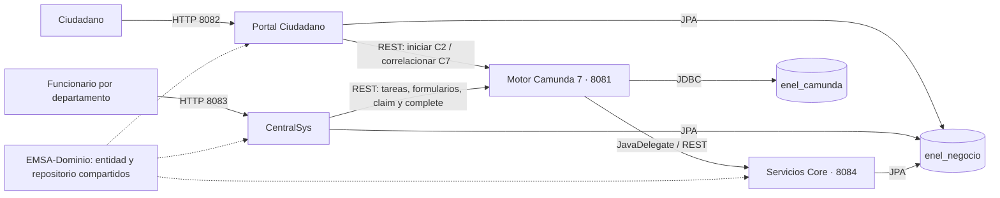

# Arquitectura distribuida ENEL

El proyecto contiene cuatro aplicaciones Spring Boot independientes y un módulo Java compartido, construidos
desde un único repositorio integrador. Camunda es el orquestador: las aplicaciones no replican el enrutamiento
de tareas del BPMN.

## Responsabilidades e interacciones

| Componente | Responsabilidad | Persistencia / integraciones |
|---|---|---|
| `EMSA_springboot/` (8081) | Camunda Platform 7.24, despliegue de BPMN/DMN/forms, REST de motor, CORS y delegates `com.soft1`. | Base exclusiva `enel_camunda`; delegates llaman a Core en 8084. |
| `EMSA-Portal-Ciudadano/` (8082) | Crear, editar, consultar y radicar borradores C2/C7; valida campos y mantiene el estado del caso. | `enel_negocio`; inicia C2 por REST y correlaciona C7 con `MsgPQRPortal`, con `codigoSolicitud` como business key. |
| `EMSA-CentralSys/` (8083) | Consultar tareas por grupo, mostrar formulario/variables, reclamar y completar tareas. | Lee y actualiza `enel_negocio`; todas las transiciones de tareas se solicitan al motor. |
| `EMSA-Servicios-Core/` (8084) | Liquidación tarifaria, validación de suministro, registro de órdenes técnicas y actualización de solicitudes. | `enel_negocio`; expone endpoints REST internos consumidos por delegates. |
| `EMSA-Dominio/` | Comparte entidad, repositorio y servicio de solicitudes entre las aplicaciones de dominio. | No es una aplicación ni abre un puerto propio. |

En una instalación local las bases son archivos H2 con `AUTO_SERVER=TRUE`: `./data/enel_camunda` desde el
directorio del motor y `../data/enel_negocio` desde cada aplicación externa. Las tres aplicaciones de dominio
deben ejecutarse desde sus respectivos directorios para apuntar al mismo archivo. PostgreSQL es una opción
para la demostración; Docker no es requisito.

## Procesos BPMN incluidos

Los modelos editables se conservan en `EMSA_springboot/src/main/resources/static.bpmn`,
`static.dmn` y `static.form`. El motor despliega los recursos automáticamente al arrancar.

| Proceso | Modelo ejecutable | Inicio / decisión visible |
|---|---|---|
| C2 · Restablecer servicio tras una falla | `RestablecerElServicioTrasUnaFalla.bpmn` y el subproceso `realizarVisitaTecnica.bpmn` | El Portal inicia `restablecerServicioTrasFalla`; la primera tarea es “Validar y correlacionar alarmas”. La compuerta permite validar o descartar la alarma. |
| C4 · Facturar el servicio de energía | `C4_FacturarServicioEnergia.bpmn` y `C4_EntregarFactura.bpmn` | Se inicia por `MsgConsumoValidado`; contiene decisiones DMN, controles de calidad y caminos de corrección/entrega. |
| C7 · Atender una PQR | `C7_AtenderPQR.bpmn` y `C7_NotificarDecision.bpmn` | El Portal correlaciona `MsgPQRPortal`; el modelo gestiona tipificación, evidencia, decisión, revisión jurídica, notificación y recursos. |

Los XML BPMN y DMN y los formularios `.form` son la fuente editable. Las imágenes de `docs/` son evidencia
de lectura, no reemplazan a los modelos.

## Evidencia para la evaluación

| Criterio | Evidencia verificable |
|---|---|
| Contexto y alcance | [README general](../README.md): organización, problema, integrantes y procesos C2/C4/C7. |
| Arquitectura | Este documento y el diagrama de componentes anterior. |
| Modelado BPMN | Los seis modelos BPMN, las tablas DMN y formularios desplegados desde recursos. |
| Ejecución Camunda | Despliegue al iniciar, REST en `/engine-rest`, Tasklist y los casos creados por la prueba integral. |
| Aplicaciones externas e internas | Guías y código de Portal Ciudadano y CentralSys, con validación y manejo de tareas. |
| Automatización | Delegate C4 que consume la liquidación REST del Core y verificación del resultado como variables Camunda; endpoints de Core y persistencia de órdenes. |
| Persistencia | `EMSA-Dominio`, entidades de órdenes, H2 local y `docker/init.sql` para PostgreSQL. |
| Instalación reproducible | Instrucciones del README general; compilar el reactor antes de arrancar las cuatro aplicaciones. |
| Pruebas integrales | `python scripts/verify-integration.py` con las cuatro aplicaciones iniciadas. |

El repositorio remoto es actualmente un monorepo integrador; cada carpeta tiene una guía y código fuente accesible
desde el mismo repositorio. La rúbrica menciona un hub multirepositorio, pero no se crean repositorios GitHub
adicionales ni se publican copias de los módulos como parte de esta entrega.
